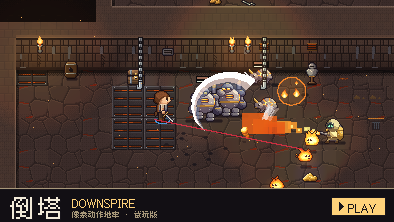

# DOWNSPIRE 倒塔 (Demo)

Play in the browser: https://aslanding.github.io/downspire/?start=1

An upside-down tower hangs in a pit, and you climb down it: eight floors through stone halls, a lava cave, a sunken city and the spire's tip, each one collapsing on a timer, a boss at the end of every act and a gate at the very bottom.

- Eight races and eight weapon families, each with its own moves
- Solo, or co-op and versus for up to four on one computer, with rule-based bots as team mates or rivals
- This demo leaves out online play and the LLM Agents; English and 中文

Plays in the browser with a keyboard and mouse or a gamepad; the first load is about 120 MB. Saves stay in this browser.

This repository holds the Godot 4 web build that GitHub Pages serves. More of my work: https://aslanding.github.io/others/
